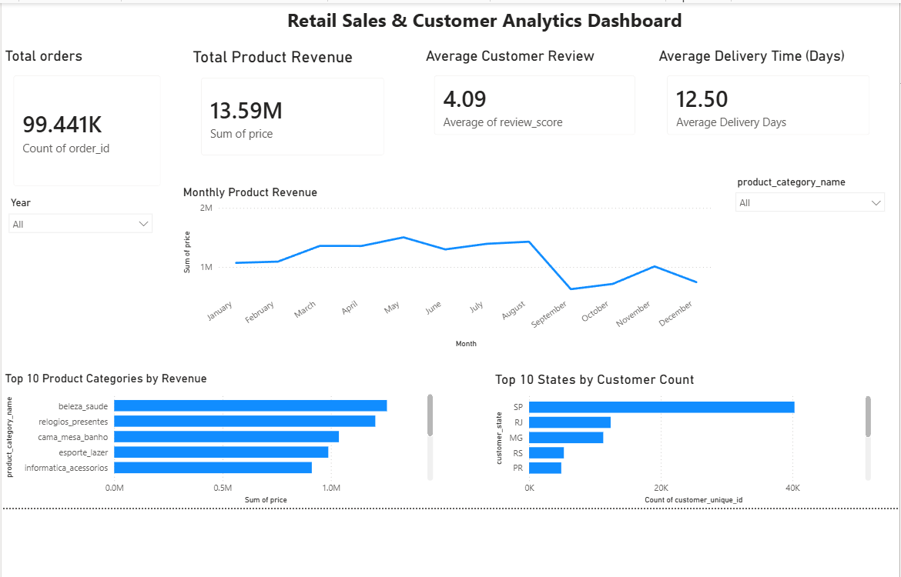

# Retail Sales & Customer Analytics Data Pipeline

## Project Overview

An end-to-end Data Engineering and Analytics project built using the Olist Brazilian E-Commerce dataset. The project extracts raw CSV data, cleans and validates it using Python, loads it into PostgreSQL, analyzes business performance using SQL, and visualizes insights through an interactive Power BI dashboard.

## Project Architecture

```text
Olist CSV Datasets
        |
        v
Python ETL Pipeline
        |
        v
Data Cleaning & Transformation
        |
        v
Automated Data Quality Checks
        |
        v
PostgreSQL Staging Tables
        |
        v
SQL Business Analytics
        |
        v
Power BI Dashboard
```

## Technologies Used

- **Python** — ETL pipeline and data validation
- **Pandas** — Data cleaning and transformation
- **PostgreSQL** — Data storage and querying
- **SQL** — Business analytics
- **SQLAlchemy** — Database connectivity
- **Power BI** — Interactive dashboard and visualization
- **python-dotenv** — Environment variable management
- **Git and GitHub** — Version control

## Dataset

Source: [Olist Brazilian E-Commerce Public Dataset](https://www.kaggle.com/datasets/olistbr/brazilian-ecommerce)

The project uses eight datasets:

| Dataset | Rows after transformation |
|---|---:|
| Customers | 99,441 |
| Geolocation | 738,332 |
| Order Items | 112,650 |
| Order Payments | 103,886 |
| Order Reviews | 99,224 |
| Orders | 99,441 |
| Products | 32,951 |
| Sellers | 3,095 |

The geolocation dataset contains 261,831 exact duplicate rows that were removed during transformation. The original raw CSV files remain unchanged.

## ETL Pipeline

### 1. Extract

- Reads eight CSV files from `data/raw/`.
- Loads the files into Pandas DataFrames.
- Reports the number of rows and columns extracted.

### 2. Transform

- Standardizes column names.
- Removes exact duplicate rows.
- Converts order timestamp columns to datetime values.
- Checks for missing required values and negative monetary values.

### 3. Data Quality Validation

Automated checks verify:

- Required columns and missing values.
- Unique keys in applicable datasets.
- Relationships between orders, customers, products, sellers, payments, and reviews.
- Non-negative monetary values.

All implemented data-quality checks passed during testing.

### 4. Load

- Connects to PostgreSQL using SQLAlchemy.
- Loads the transformed datasets into staging tables.
- Uses environment variables to manage database connection settings.

## SQL Business Analytics

The SQL analysis covers:

1. Row counts for the staging tables.
2. Monthly order volume.
3. Monthly product revenue.
4. Top 10 product categories by revenue.
5. Top 10 customer states by customer count.
6. Average customer review score.
7. Average delivery time.
8. Top 10 sellers by product revenue.

Product revenue is calculated from order-item prices and excludes freight charges.

## Power BI Dashboard

The interactive dashboard includes:

- **Total Orders** — Total number of orders.
- **Total Product Revenue** — Sum of product prices.
- **Average Customer Review** — Average review score out of 5.
- **Average Delivery Time** — Average number of days between purchase and customer delivery.
- **Monthly Product Revenue** — Revenue trends over time.
- **Top 10 Product Categories** — Categories ranked by revenue.
- **Top 10 States by Customer Count** — Geographic customer distribution.
- **Interactive slicers** — Filter results by order year and product category.

### Dashboard Preview



## Project Structure

```text
retail-data-pipeline/
├── data/
│   ├── raw/
│   └── processed/
├── images/
│   └── dashboard.png
├── src/
│   ├── extract.py
│   ├── transform.py
│   ├── data_quality.py
│   ├── load.py
│   └── main.py
├── sql/
│   ├── schema.sql
│   └── analytics.sql
├── tests/
├── .env
├── .gitignore
├── requirements.txt
├── check_dataset.py
├── Retail_Sales_Analytics.pbix
└── README.md
```

## How to Run the Project

### Prerequisites

- Python installed
- PostgreSQL installed and running
- Git installed
- Power BI Desktop for viewing the dashboard

### Setup

1. Clone the repository:

   ```bash
   git clone YOUR_GITHUB_REPOSITORY_URL
   cd retail-data-pipeline
   ```

2. Create a virtual environment:

   ```bash
   python -m venv .venv
   ```

3. Activate the environment on Windows PowerShell:

   ```powershell
   .\.venv\Scripts\Activate.ps1
   ```

4. Install dependencies:

   ```bash
   pip install -r requirements.txt
   ```

5. Download the Olist dataset from Kaggle and place the eight required CSV files in `data/raw/`.

6. Create a PostgreSQL database named `retail_analytics`.

7. Create a `.env` file in the project root with your own database settings:

   ```text
   DB_HOST=localhost
   DB_PORT=5432
   DB_NAME=retail_analytics
   DB_USER=postgres
   DB_PASSWORD=your_local_database_password
   ```

8. Run the ETL pipeline:

   ```bash
   python -m src.main
   ```

9. Connect Power BI Desktop to the PostgreSQL database to view the dashboard.

## Security

- Database credentials are stored in `.env`.
- The `.env` file and `.venv/` directory must not be committed to GitHub.
- Raw and processed data files are excluded from Git where configured in `.gitignore`.
- Never publish real database passwords or other secrets.

## Future Improvements

- Add automated unit tests using pytest.
- Improve logging and error handling.
- Add incremental loading instead of replacing staging tables on each run.
- Build analytical tables or a star schema for reporting.
- Automate pipeline execution.
- Explore cloud deployment using AWS services.

## Author

Developed as a Data Engineering and Analytics portfolio project using Python, PostgreSQL, SQL, and Power BI.
